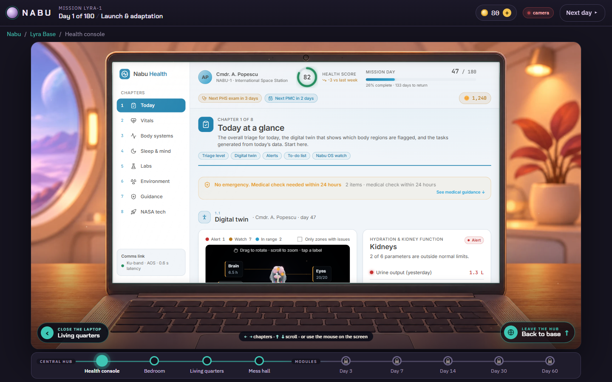
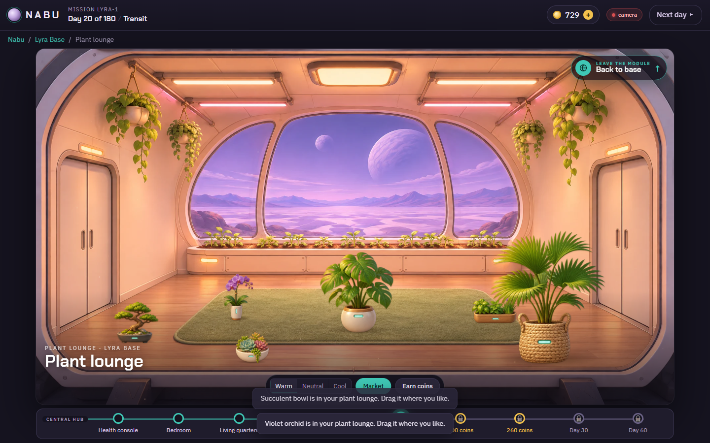

<h1 align="center">🪐 Nabu</h1>
<p align="center"><b>A cozy space-habitat game about astronaut health</b><br>NASA Space Apps Challenge 2026</p>
<p align="center"><a href="https://nabu-lyra.vercel.app"><b>▶ Play Nabu in your browser</b></a> &nbsp;·&nbsp; <a href="https://nabu-lyra.vercel.app/?test"><b>⚡ Quick test (everything unlocked)</b></a></p>

<p align="center"></p>

You live on the planet Nabu for a 180-day mission. Decorate your base, keep a journal, look after your body and mind,
and check your health on the laptop in the Health console.

| | |
|---|---|
| **Base & rooms** | A central hub with living quarters, bedroom, mess hall and the Health console, plus modules you unlock and build. |
| **Health console** | The Nabu Health app on a laptop: vitals, body systems, sleep & mind, labs, environment, guidance and NASA tech. |
| **Journals** | A personal journal and a community journal. The on-device Guardian flags risk to the psychologist without sending the text. |
| **Plant lounge & market** | Buy furniture and plants and arrange them in your rooms. |
| **Psychologist console** | A live view of fatigue readings and assessments. It never shows journal text, answers or camera images. |

<p align="center"></p>

## Try it

- **Play:** https://nabu-lyra.vercel.app
- **Quick test:** https://nabu-lyra.vercel.app/?test (every module built, day 30, 2,500 coins, a shortcuts panel to skip days and open the psychologist view)

## Run it locally

```
python -m http.server 8765
```
then open http://localhost:8765 (or double-click `start.bat` on Windows).

All health data in the prototype is simulated.
